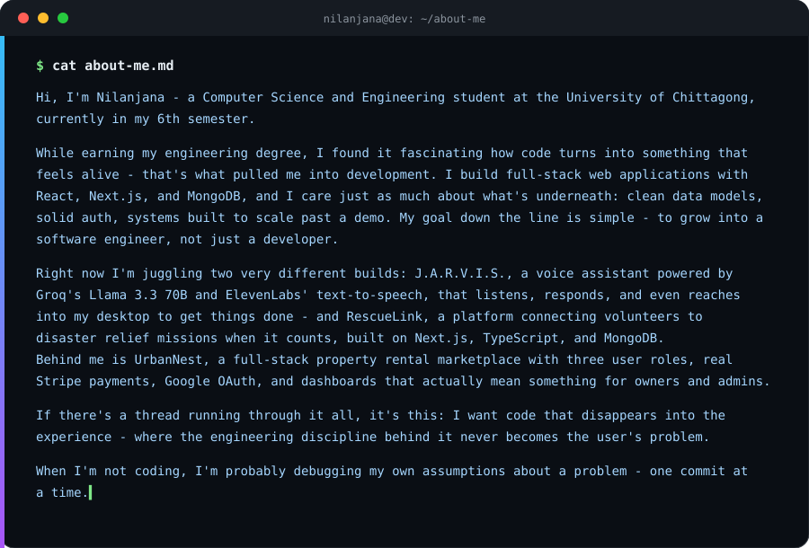

<table>
<tr>
<td valign="top">

</td>
<td valign="top">

</td>
</tr>
</table>

 

---

---

# 👩‍💻 About Me

---

# 🧩 What I Build

| Area | Focus |
|---|---|
| 🌐 Web Development | React, Next.js, responsive interfaces |
| ⚙️ Backend Development | Node.js, Express.js, REST APIs |
| 🔐 Application Security | Authentication, authorization, protected workflows |
| 🗄️ Databases | MongoDB, MySQL, relational database design |
| 🧠 Problem Solving | Algorithms, data structures, competitive programming |
| 🏗️ Software Design | Modular architecture and system design |

---

# 🛠️ Tech Stack

### 💻 Languages

### 🌐 Frontend

### ⚙️ Backend & Authentication

### 🗄️ Databases

### 🔧 Tools & Platforms

---

# 🚀 Featured Projects

### 🏙️ UrbanNest

**Full-Stack Property Rental Marketplace**

**Tech:** `Next.js` `React` `MongoDB` `Better Auth` `Stripe` `Tailwind CSS`

A property rental platform with separate Tenant, Owner, and Admin workflows.

**Highlights**
- Role-based dashboards
- Property listing and management
- Booking workflow
- Stripe payment integration
- Revenue analytics
- Authentication and protected routes

[**Live Demo →**](https://urbannest-property-rental-client.vercel.app)

---

### 🛟 RescueLink

**Disaster Relief Coordination Platform**

**Tech:** `Next.js` `TypeScript` `Better Auth` `Tailwind CSS`

A platform designed to coordinate volunteers and active rescue missions through structured role-based workflows.

**Highlights**
- Volunteer and mission workflows
- Role-based access
- Mission management
- Responsive dashboard interfaces
- Authentication and protected functionality

[**Live Demo →**](https://rescuelink-client.vercel.app)

---

### 🚗 DriveFleet

**Car Rental Management Platform**

**Tech:** `Next.js` `MongoDB` `Better Auth` `Tailwind CSS`

A full-stack car rental application focused on vehicle discovery, booking, authentication, and management workflows.

**Highlights**
- Email and Google authentication
- Vehicle management
- Search and filtering
- Booking management
- MongoDB-based data handling
- Responsive dashboards

[**Live Demo →**](https://drivefleet-client-sigma.vercel.app)

---

### 🗄️ Database Design Studio

**Interactive Database Design & Schema Tool**

**Tech:** `Flask` `React` `Python`

A tool for processing structured datasets and assisting with database schema design and normalization.

**Highlights**
- Dataset processing
- Schema generation
- Database normalization workflow
- Interactive schema visualization

[**Live Demo →**](https://database-design-studio.netlify.app)

---

# 📚 Currently Building & Learning

I'm currently deepening my skills in:

- Full-stack application architecture
- Backend API design
- Database design and optimization
- Authentication and authorization
- System design
- Data structures and algorithms
- Building software around real-world problems

---

# 📈 GitHub Analytics

  

---

# 🔥 GitHub Streak

---

# 🐍 Contribution Snake

---

# 🌍 Portfolio

---

# 🌐 Connect With Me

---

### ⭐ Thanks for visiting my profile!

**Building, learning, and turning ideas into software.**

